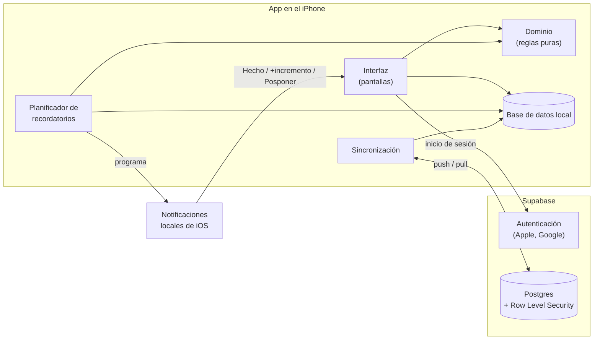
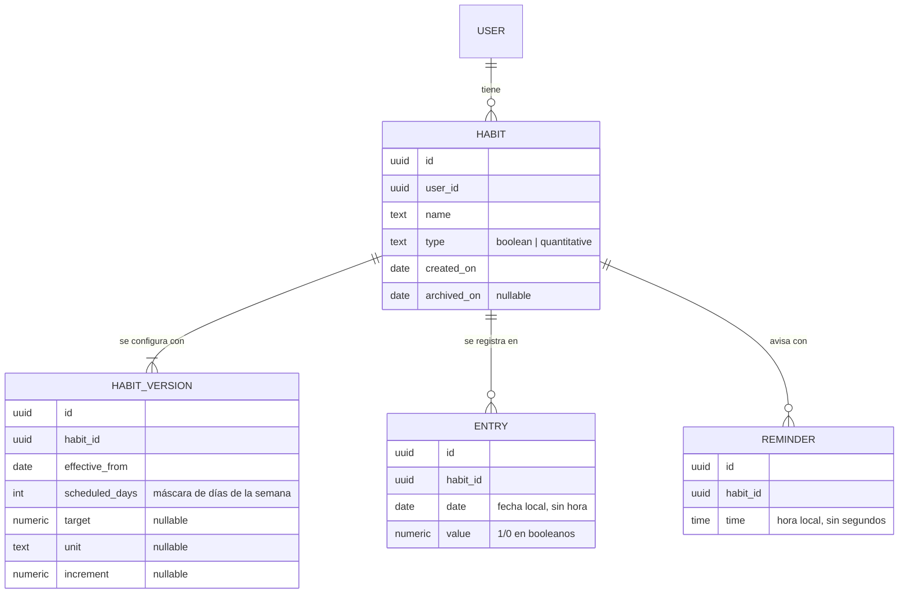

# Arquitectura

Cómo se construye la aplicación descrita en la [especificación funcional](especificacion-funcional.md). Las decisiones importantes se justifican en los [ADR](adr/); este documento resume el resultado.

## 1. Objetivos de calidad

Derivados de los principios de la especificación funcional:

| Prioridad | Objetivo | Qué implica |
|-----------|----------|-------------|
| 1 | **Recordatorios fiables** | Se generan en el propio dispositivo; no dependen de conexión ni de un servidor. |
| 2 | **Funciona sin conexión** | El dispositivo guarda los datos y es la fuente de verdad para la interfaz. La nube es copia y sincronización. |
| 3 | **Respuesta inmediata** | Marcar un hábito no espera a la red. |
| 4 | **Simplicidad** | Mínimo número de piezas, servicios gestionados, nada de servidores propios. |
| 5 | **Coste cero o casi** | Solo el Apple Developer Program es de pago. |

## 2. Visión general



- La **interfaz** solo lee y escribe en la base de datos local, así que nunca espera a la red.
- El **dominio** no accede a la base de datos ni a ninguna otra pieza: recibe los datos que le pasan la interfaz o el planificador y devuelve el resultado.
- La **sincronización** copia los cambios entre la base local y Supabase en segundo plano.
- El **planificador de recordatorios** calcula qué avisos tocan y los programa como notificaciones locales de iOS.

## 3. Tecnologías

| Área | Elección | Decisión |
|------|----------|----------|
| Plataforma | Expo (React Native) con TypeScript en modo estricto | [ADR-0002](adr/0002-expo-como-plataforma.md) |
| Navegación | Expo Router (rutas basadas en ficheros): el día como única pantalla principal, sin cabecera, y los formularios como modales | [ADR-0010](adr/0010-interfaz-por-gestos-hooks-propios-sobre-expo-sqlite-y-estilos-sin-libreria.md) |
| Gestos y animaciones | `react-native-gesture-handler` y `react-native-reanimated`: el calendario, el menú y las opciones de un hábito son capas de la pantalla principal | [ADR-0010](adr/0010-interfaz-por-gestos-hooks-propios-sobre-expo-sqlite-y-estilos-sin-libreria.md) |
| Datos en la interfaz | Hooks propios sobre `SQLiteProvider` de `expo-sqlite`, sin caché ni store global | [ADR-0010](adr/0010-interfaz-por-gestos-hooks-propios-sobre-expo-sqlite-y-estilos-sin-libreria.md) |
| Estilos | `StyleSheet` con tokens propios y modo oscuro, sin librería de UI | [ADR-0010](adr/0010-interfaz-por-gestos-hooks-propios-sobre-expo-sqlite-y-estilos-sin-libreria.md) |
| Iconos | SF Symbols con `expo-symbols`, con un sustituto sencillo donde no hay | [ADR-0011](adr/0011-sf-symbols-con-expo-symbols-para-los-iconos.md) |
| Base de datos local | SQLite (`expo-sqlite`), con SQL directo y migraciones propias | [ADR-0004](adr/0004-offline-first-con-sincronizacion.md), [ADR-0009](adr/0009-sql-directo-y-migraciones-propias-en-la-capa-de-datos-local.md) |
| Backend y autenticación | Supabase (Postgres, Auth) | [ADR-0003](adr/0003-supabase-como-backend.md) |
| Inicio de sesión | Sign in with Apple y Google nativos, con el token enviado a Supabase | [ADR-0003](adr/0003-supabase-como-backend.md) |
| Recordatorios | Notificaciones locales (`expo-notifications`) | [ADR-0005](adr/0005-recordatorios-locales-en-ventana-deslizante.md) |
| Compilación y publicación | EAS Build, EAS Submit y TestFlight | [ADR-0002](adr/0002-expo-como-plataforma.md) |
| Tests | Jest y React Native Testing Library | Estándar de Expo |
| Calidad de código | ESLint y Prettier | Estándar de Expo |
| Variantes | Desarrollo y producción, con identidad propia cada una | [ADR-0008](adr/0008-variantes-de-desarrollo-y-produccion.md) |
| Idioma | Código en inglés, documentación en español | [ADR-0007](adr/0007-codigo-en-ingles-y-documentacion-en-espanol.md) |

Las versiones concretas se fijan al crear el proyecto y quedan registradas en `package.json`.

## 4. Capas y estructura del código

```
src/
  app/            Pantallas y navegación (Expo Router: cada fichero es una ruta)
  domain/         Reglas de negocio puras, sin dependencias de React ni de la base de datos
  data/           Acceso a la base de datos local (esquema, migraciones, repositorios)
  sync/           Sincronización con Supabase
  notifications/  Planificador de recordatorios y gestión de acciones
  auth/           Inicio y cierre de sesión, eliminación de cuenta
  ui/             Componentes visuales reutilizables, tokens de estilo y hooks de datos de las pantallas
supabase/         Migraciones SQL y políticas de seguridad del backend
```

Regla de dependencias: `app` y `ui` pueden usar todo; `domain` no depende de nada. Así las reglas más delicadas (qué hábitos tocan un día, cuándo está cumplido, qué recordatorios hay que programar) son funciones puras que se prueban con tests unitarios rápidos. ESLint impone esta regla en `src/domain`.

Convenciones del dominio:

- **No consulta el reloj ni genera identificadores.** "Hoy" y los UUID se le pasan como datos, así que el mismo dato de entrada da siempre el mismo resultado.
- **Las reglas que pueden rechazar una operación devuelven códigos de error** (por ejemplo, `name_empty`), no textos. La interfaz decide el mensaje.
- **Los tests van junto al código** (`dates.ts` y `dates.test.ts`) y la cobertura del dominio y de la capa de datos debe ser del 100 %: `npm run verify` falla si baja.
- **La capa de datos** (`src/data`) solo depende del dominio, y sus repositorios usan una interfaz mínima de base de datos en lugar de `expo-sqlite`. Así los tests ejecutan el SQL real con el SQLite integrado en Node ([ADR-0009](adr/0009-sql-directo-y-migraciones-propias-en-la-capa-de-datos-local.md)). ESLint impone también esta dependencia.

Las pantallas están en `src/app/` porque es la ubicación de la plantilla de Expo; dentro solo van rutas, y los tests van fuera (en `src/__tests__/` o junto al código que prueban, fuera de `src/app/`). Los imports usan el alias `@/` → `src/`.

## 5. Modelo de datos

La especificación exige que los cambios en un hábito se apliquen solo hacia delante (RF-09) y que los días pasados muestren lo que tocaba entonces. Por eso la configuración de un hábito se guarda con **fecha de vigencia** ([ADR-0006](adr/0006-configuracion-de-habitos-con-vigencia.md)).

Los nombres del modelo están en inglés ([ADR-0007](adr/0007-codigo-en-ingles-y-documentacion-en-espanol.md)); su equivalencia con los términos de la especificación está en el [glosario](especificacion-funcional.md#2-glosario).



Decisiones del modelo:

- **Las fechas son fechas de calendario** (`2026-10-28`), no instantes con hora. El día va de 00:00 a 23:59 en la hora local del dispositivo y no cambia si el usuario viaja a otra zona horaria.
- **Qué hábitos tocan el día D:** los que se crearon como mucho en D, no están retirados por archivado en D y, según la versión vigente en D (la de mayor `effective_from` que sea ≤ D), están programados para ese día de la semana.
- **Archivado:** un hábito archivado deja de tocar a partir del día siguiente al archivado. El propio día del archivado solo toca si ya tiene algo registrado (RF-10). Archivar no se deshace: `archived_on` es una sola fecha, y reactivar exigiría guardar periodos de actividad para que los días intermedios no aparezcan como incumplidos (fuera del alcance del MVP).
- **Edición desde cualquier día:** la configuración nueva siempre entra en vigor el día actual (`effective_from` = hoy), aunque se edite desde un día pasado o futuro (RF-09). Lo que pertenece al día que se está viendo es su registro.
- **Días programados:** máscara de 7 bits en `scheduled_days`, con el lunes en el bit 0 y el domingo en el bit 6.
- **Cantidades:** `target`, `increment` y `value` tienen 2 decimales como máximo y nunca son negativas. Un registro con valor 0 equivale a no tener registro.
- **Un registro por hábito y día** (clave única `habit_id + date`). Si no hay registro, el hábito está pendiente.
- **Las horas son horas del día** (`08:30`), con precisión de minuto y sin zona horaria, igual que las fechas.
- **Los recordatorios no tienen versiones**: solo afectan al futuro. Un hábito no puede tener dos a la misma hora (clave única `habit_id + time`).
- **Qué recordatorios se programan:** a partir de ahora y por cercanía, los de cada hábito en sus días programados, salvo que el hábito esté cumplido ese día o archivado. Como mucho 60 ([ADR-0005](adr/0005-recordatorios-locales-en-ventana-deslizante.md)). Cada aviso lleva el progreso del hábito ese día para poder mostrarlo.
- **Campos de sincronización** en todas las tablas: identificador generado en el dispositivo (UUID), `updated_at` asignado por el servidor y `deleted` (borrado lógico) para propagar eliminaciones.
- **En la base local** no existe `user_id` (es de un solo usuario) y cada tabla añade `pending_sync`, que marca las filas con cambios sin subir. Las claves únicas ignoran las filas borradas.
- **Migraciones locales:** lista ordenada en `src/data/migrations.ts`; la base guarda su versión y al abrir se aplican las que faltan. Una migración publicada no se edita.

## 6. Flujos principales

### Marcar un hábito

1. La interfaz escribe el registro en la base local y se actualiza al instante. Solo cambia el estado de la fila: la pantalla conserva el orden que calculó al mostrar el día, y la lista se reordena la próxima vez que se muestra (RF-12).
2. El planificador cancela los recordatorios restantes de ese hábito para hoy si ya está cumplido (RF-24).
3. La sincronización sube el cambio cuando hay conexión.

### Acción desde un recordatorio

1. iOS muestra la notificación con sus botones ("Hecho" o "+incremento", y "Posponer").
2. La acción se recibe en la app sin abrirla en primer plano y se ejecuta el mismo flujo de "Marcar un hábito".
3. "Posponer" programa una notificación nueva para una hora después. Si esa hora cae en el día siguiente, no programa nada. Las notificaciones pospuestas no forman parte de la ventana de 60: usan el margen que deja hasta las 64 de iOS.

### Sincronización

1. **Push:** se suben las filas modificadas en el dispositivo desde la última sincronización.
2. **Pull:** se descargan las filas que el servidor ha modificado desde el último `updated_at` recibido.
3. En caso de conflicto, gana la última escritura. Es aceptable porque cada cuenta tiene un solo usuario.
4. Se lanza al abrir la app, al volver a primer plano, tras cada cambio local y al recuperar la conexión.

## 7. Seguridad y privacidad

- Cada fila de Supabase lleva `user_id`, y las políticas de **Row Level Security** impiden que un usuario lea o modifique datos de otro.
- La app usa solo la clave pública (`anon`) de Supabase. Ninguna clave privada vive en la app ni en el repositorio.
- Los secretos y la configuración por entorno van en variables de entorno de EAS, nunca en git (ver `.gitignore`).
- Eliminar la cuenta (RF-04) borra al usuario y, en cascada, todos sus datos.

## 8. Entornos y publicación

| Entorno | Aplicación | Uso | Backend |
|---------|------------|-----|---------|
| Desarrollo | Hábitos Dev (`com.jotamarcar.habitos.dev`) | Development build en el iPhone, conectado al servidor de desarrollo del PC por wifi | Proyecto Supabase de desarrollo |
| Producción | Hábitos (`com.jotamarcar.habitos`) | Build de producción distribuido por TestFlight (y, más adelante, la App Store) | Proyecto Supabase de producción |

- Cada entorno es una variante de la aplicación con su propio nombre, identificador y scheme, así que las dos conviven en el mismo iPhone sin compartir datos ([ADR-0008](adr/0008-variantes-de-desarrollo-y-produccion.md)).
- La variante la decide `APP_VARIANT`, que fija cada perfil de `eas.json`. Si falta, es desarrollo; un valor desconocido detiene la compilación.
- Lo que cambia entre variantes está en `app.config.ts`; lo común, en `app.json`.

- Los cambios solo de JavaScript pueden llegar a producción con **EAS Update**, sin pasar por una nueva compilación.
- Los cambios nativos (dependencias nuevas, permisos) requieren una compilación con EAS Build y una nueva versión en TestFlight.
- La CI (GitHub Actions) verifica cada Pull Request: formato, lint, tipos y tests (ver [CONTRIBUTING.md](../CONTRIBUTING.md#8-integración-continua)). Compilar y publicar desde la CI queda para más adelante.

## 9. Riesgos conocidos

| Riesgo | Mitigación |
|--------|------------|
| iOS solo mantiene 64 notificaciones locales pendientes por app | Ventana deslizante de recordatorios, que se recalcula en cada apertura y cambio ([ADR-0005](adr/0005-recordatorios-locales-en-ventana-deslizante.md)) |
| Si la app no se abre en varios días, la ventana de recordatorios se agota | Tarea en segundo plano que la rellena; aviso en la app si los permisos están desactivados |
| El plan gratuito de Supabase pausa el proyecto tras 7 días sin peticiones | Con el uso diario de la app no ocurre; si ocurre, se reactiva desde el panel sin perder datos |
| Dependencia de EAS para compilar iOS (no hay Mac) | Asumida en [ADR-0002](adr/0002-expo-como-plataforma.md); alternativa: alquilar un Mac en la nube |
| Hecho en un dispositivo, recordatorio en otro | El recordatorio del otro dispositivo puede sonar si no ha sincronizado. Aceptable con un solo dispositivo por usuario |
