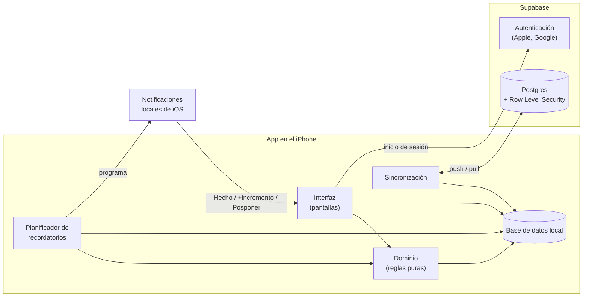
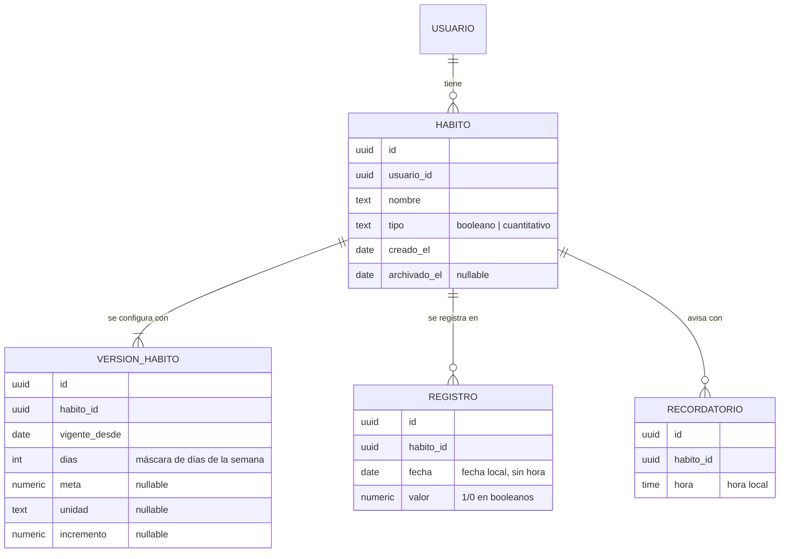

# Arquitectura

Cómo se construye la aplicación descrita en la [especificación funcional](especificacion-funcional.md). Las decisiones importantes se justifican en los [ADR](adr/); este documento resume el resultado.

## 1. Objetivos de calidad

Derivados de los principios de la especificación funcional:

| Prioridad | Objetivo | Qué implica |
|-----------|----------|-------------|
| 1 | **Recordatorios fiables** | Se generan en el propio dispositivo; no dependen de conexión ni de un servidor. |
| 2 | **Funciona sin conexión** | El dispositivo guarda los datos y es la fuente de verdad para la interfaz. La nube es copia y sincronización. |
| 3 | **Respuesta inmediata** | Marcar un hábito no espera a la red. |
| 4 | **Simplicidad** | Mínimo número de piezas, servicios gestionados, nada de servidores propios. |
| 5 | **Coste cero o casi** | Solo el Apple Developer Program es de pago. |

## 2. Visión general



- La **interfaz** solo lee y escribe en la base de datos local, así que nunca espera a la red.
- La **sincronización** copia los cambios entre la base local y Supabase en segundo plano.
- El **planificador de recordatorios** calcula qué avisos tocan y los programa como notificaciones locales de iOS.

## 3. Tecnologías

| Área | Elección | Decisión |
|------|----------|----------|
| Plataforma | Expo (React Native) con TypeScript en modo estricto | [ADR-0002](adr/0002-expo-como-plataforma.md) |
| Navegación | Expo Router (rutas basadas en ficheros) | Estándar de Expo |
| Base de datos local | SQLite (`expo-sqlite`) | [ADR-0004](adr/0004-offline-first-con-sincronizacion.md) |
| Backend y autenticación | Supabase (Postgres, Auth) | [ADR-0003](adr/0003-supabase-como-backend.md) |
| Inicio de sesión | Sign in with Apple y Google nativos, con el token enviado a Supabase | [ADR-0003](adr/0003-supabase-como-backend.md) |
| Recordatorios | Notificaciones locales (`expo-notifications`) | [ADR-0005](adr/0005-recordatorios-locales-en-ventana-deslizante.md) |
| Compilación y publicación | EAS Build, EAS Submit y TestFlight | [ADR-0002](adr/0002-expo-como-plataforma.md) |
| Tests | Jest y React Native Testing Library | Estándar de Expo |
| Calidad de código | ESLint y Prettier | Estándar de Expo |

Las versiones concretas se fijan al crear el proyecto y quedan registradas en `package.json`.

## 4. Capas y estructura del código

```
src/
  app/            Pantallas y navegación (Expo Router: cada fichero es una ruta)
  domain/         Reglas de negocio puras, sin dependencias de React ni de la base de datos
  data/           Acceso a la base de datos local (esquema, migraciones, repositorios)
  sync/           Sincronización con Supabase
  notifications/  Planificador de recordatorios y gestión de acciones
  auth/           Inicio y cierre de sesión, eliminación de cuenta
  ui/             Componentes visuales reutilizables
supabase/         Migraciones SQL y políticas de seguridad del backend
```

Regla de dependencias: `app` y `ui` pueden usar todo; `domain` no depende de nada. Así las reglas más delicadas (qué hábitos tocan un día, cuándo está cumplido, qué recordatorios hay que programar) son funciones puras que se prueban con tests unitarios rápidos. ESLint impone esta regla en `src/domain`.

Las pantallas están en `src/app/` porque es la ubicación de la plantilla de Expo; dentro solo van rutas, y los tests van fuera (en `src/__tests__/` o junto al código que prueban, fuera de `src/app/`). Los imports usan el alias `@/` → `src/`.

## 5. Modelo de datos

La especificación exige que los cambios en un hábito se apliquen solo hacia delante (RF-09) y que los días pasados muestren lo que tocaba entonces. Por eso la configuración de un hábito se guarda con **fecha de vigencia** ([ADR-0006](adr/0006-configuracion-de-habitos-con-vigencia.md)).



Decisiones del modelo:

- **Las fechas son fechas de calendario** (`2026-10-28`), no instantes con hora. El día va de 00:00 a 23:59 en la hora local del dispositivo y no cambia si el usuario viaja a otra zona horaria.
- **Qué hábitos tocan el día D:** los que se crearon como mucho en D, no están archivados en D y, según la versión vigente en D (la de mayor `vigente_desde` que sea ≤ D), están programados para ese día de la semana.
- **Un registro por hábito y día** (clave única `habito_id + fecha`). Si no hay registro, el hábito está pendiente.
- **Los recordatorios no tienen versiones**: solo afectan al futuro.
- **Campos de sincronización** en todas las tablas: identificador generado en el dispositivo (UUID), `actualizado_en` asignado por el servidor y `borrado` (borrado lógico) para propagar eliminaciones.

## 6. Flujos principales

### Marcar un hábito

1. La interfaz escribe el registro en la base local y se actualiza al instante.
2. El planificador cancela los recordatorios restantes de ese hábito para hoy si ya está cumplido (RF-24).
3. La sincronización sube el cambio cuando hay conexión.

### Acción desde un recordatorio

1. iOS muestra la notificación con sus botones ("Hecho" o "+incremento", y "Posponer").
2. La acción se recibe en la app sin abrirla en primer plano y se ejecuta el mismo flujo de "Marcar un hábito".
3. "Posponer" programa una notificación nueva para más tarde.

### Sincronización

1. **Push:** se suben las filas modificadas en el dispositivo desde la última sincronización.
2. **Pull:** se descargan las filas que el servidor ha modificado desde el último `actualizado_en` recibido.
3. En caso de conflicto, gana la última escritura. Es aceptable porque cada cuenta tiene un solo usuario.
4. Se lanza al abrir la app, al volver a primer plano, tras cada cambio local y al recuperar la conexión.

## 7. Seguridad y privacidad

- Cada fila de Supabase lleva `usuario_id`, y las políticas de **Row Level Security** impiden que un usuario lea o modifique datos de otro.
- La app usa solo la clave pública (`anon`) de Supabase. Ninguna clave privada vive en la app ni en el repositorio.
- Los secretos y la configuración por entorno van en variables de entorno de EAS, nunca en git (ver `.gitignore`).
- Eliminar la cuenta (RF-04) borra al usuario y, en cascada, todos sus datos.

## 8. Entornos y publicación

| Entorno | Uso | Backend |
|---------|-----|---------|
| Desarrollo | Development build en el iPhone, conectado al servidor de desarrollo del PC por wifi | Proyecto Supabase de desarrollo |
| Producción | Build de producción distribuido por TestFlight (y, más adelante, la App Store) | Proyecto Supabase de producción |

- Los cambios solo de JavaScript pueden llegar a producción con **EAS Update**, sin pasar por una nueva compilación.
- Los cambios nativos (dependencias nuevas, permisos) requieren una compilación con EAS Build y una nueva versión en TestFlight.
- Se automatizará con CI (GitHub Actions) más adelante; queda fuera de este documento hasta entonces.

## 9. Riesgos conocidos

| Riesgo | Mitigación |
|--------|------------|
| iOS solo mantiene 64 notificaciones locales pendientes por app | Ventana deslizante de recordatorios, que se recalcula en cada apertura y cambio ([ADR-0005](adr/0005-recordatorios-locales-en-ventana-deslizante.md)) |
| Si la app no se abre en varios días, la ventana de recordatorios se agota | Tarea en segundo plano que la rellena; aviso en la app si los permisos están desactivados |
| El plan gratuito de Supabase pausa el proyecto tras 7 días sin peticiones | Con el uso diario de la app no ocurre; si ocurre, se reactiva desde el panel sin perder datos |
| Dependencia de EAS para compilar iOS (no hay Mac) | Asumida en [ADR-0002](adr/0002-expo-como-plataforma.md); alternativa: alquilar un Mac en la nube |
| Hecho en un dispositivo, recordatorio en otro | El recordatorio del otro dispositivo puede sonar si no ha sincronizado. Aceptable con un solo dispositivo por usuario |
